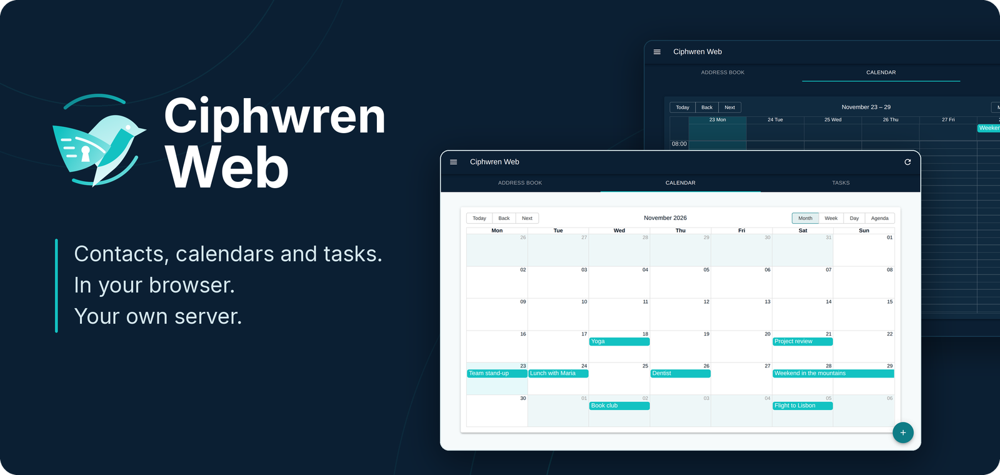
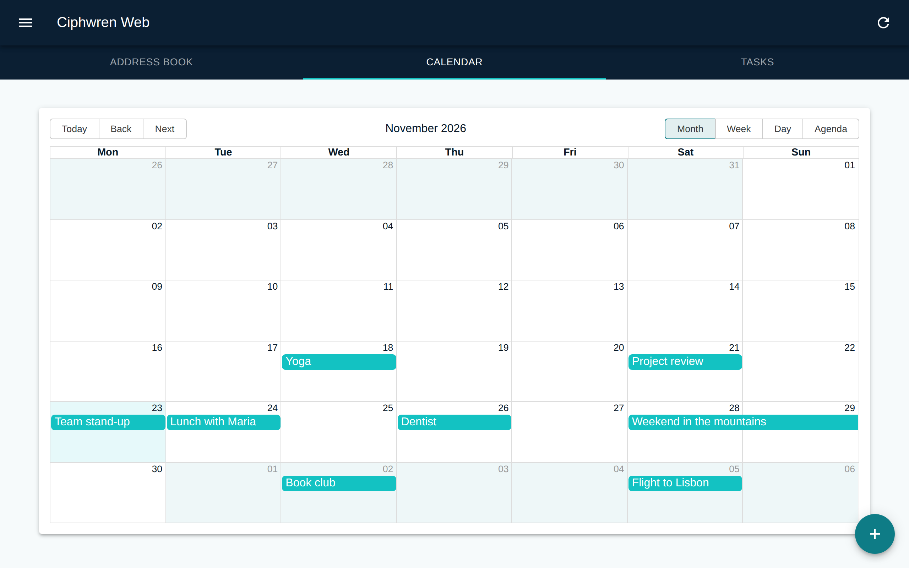
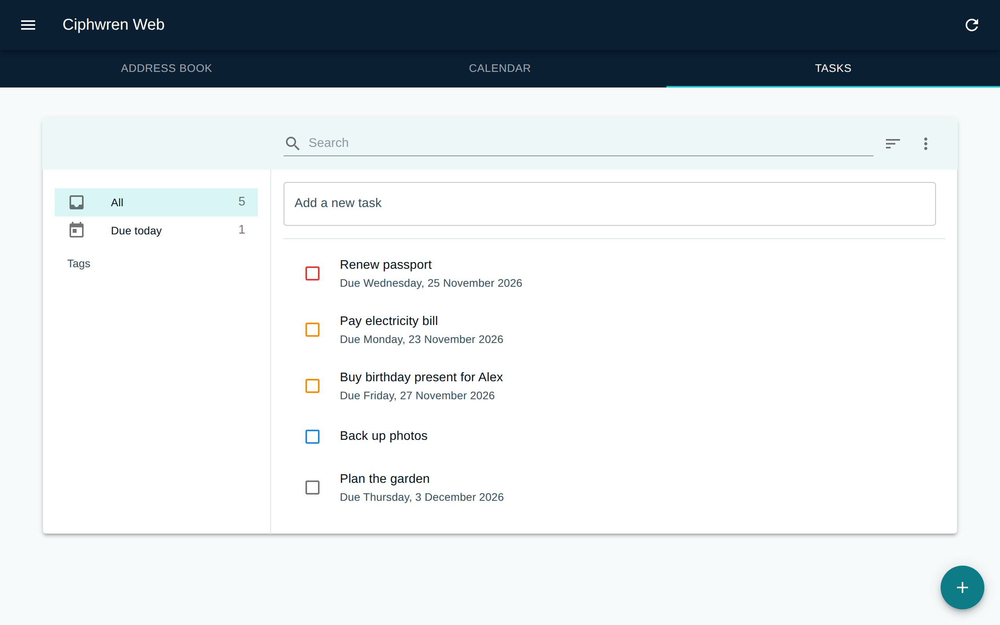
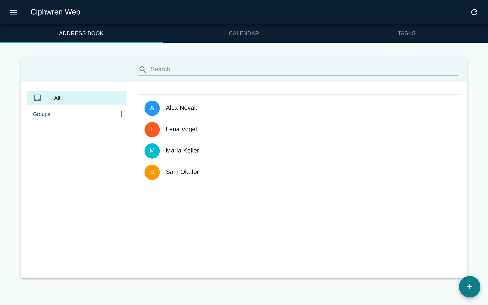
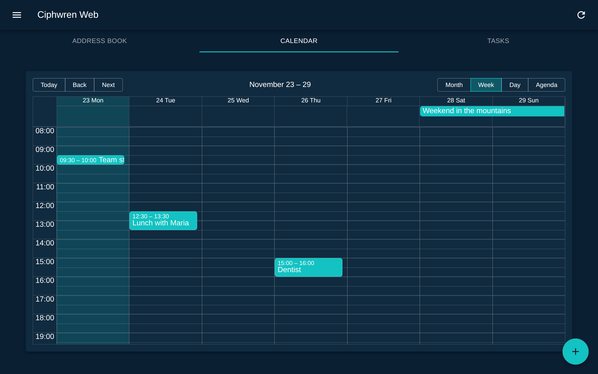

<p align="center">
  
</p>

<p align="center">
  End-to-end encrypted contacts, calendars and tasks in the browser.<br />
  Syncs with an Etebase server you run yourself.
</p>

<p align="center">
  <a href="https://github.com/nikossvnk/ciphwren-web/releases"><strong>Download a release</strong></a>
  &nbsp;·&nbsp;
  <a href="#running-it">Running it</a>
  &nbsp;·&nbsp;
  <a href="#building-it-yourself">Building it yourself</a>
  &nbsp;·&nbsp;
  <a href="#development">Development</a>
</p>

## What's in it

| Calendar | Tasks | Contacts |
| --- | --- | --- |
| Month, week, day and agenda views, repeating events and time zones. | Priorities, due dates, tags and subtasks, with a quick "add a new task" box. | Address books and groups, with phone numbers, emails, addresses and more. |
| Several calendars, each with its own color. | Filter by due today or tags; sort, and show or hide completed tasks. | Search across all contacts. |

- Everything is encrypted on your device before it's sent; the server only stores what it can't read.
- Import `.ics` and `.vcf` files, and see the change history of every item.
- Light and dark themes.

For notes and bookmarks, see [Ciphwren Notes](https://github.com/nikossvnk/ciphwren-notes) (Android) and
[Ciphwren Desktop](https://github.com/nikossvnk/ciphwren-desktop) (Linux, everything in one app).

<details>
<summary>Screenshots</summary>

| Calendar | Tasks |
| :---: | :---: |
| [](.github/screenshots/calendar.png) | [](.github/screenshots/tasks.png) |

| Contacts | Dark mode |
| :---: | :---: |
| [](.github/screenshots/contacts.png) | [](.github/screenshots/dark-mode.png) |

</details>

## Running it

You need an Etebase server, e.g. [ciphwren-server](https://github.com/nikossvnk/ciphwren-server). The app has no
default server: the login and signup pages ask for its URL (e.g. `https://etebase.example.com`).

Each [release](https://github.com/nikossvnk/ciphwren-web/releases) has the built app as
`ciphwren-web-<version>.tgz`, with its SHA-256 checksum. Check the checksum, extract it
(`tar -xzf ciphwren-web-<version>.tgz`) and serve the `ciphwren-web` directory with a web server. Opening the HTML
files directly in the browser doesn't work.

- **Locally:** `python3 -m http.server` inside the extracted directory, then open the address it prints.
- **On a server:** use a proper web server such as Caddy or nginx, with a fallback to `index.html` for unknown paths
  (the app uses client-side routing).

## Building it yourself

You need [Node.js](https://nodejs.org/) 20.19 or newer (it comes with `npm`).

```
npm ci
npm run build        # a production build in build/; serve it like a release
```

Build-time settings, as environment variables:

| Variable | What it does |
| --- | --- |
| `REACT_APP_DEFAULT_API_PATH` | A default server, so people don't have to enter it (another one can still be set under "Advanced settings"). |
| `VITE_SIGNUP_URL` | Sends "create an account" to this URL instead of the signup form, for a service that creates accounts on its own site. |
| `PUBLIC_URL` | Serves the app from a subdirectory, e.g. `/subdir-name/`. |

```
REACT_APP_DEFAULT_API_PATH=https://etebase.example.com/ VITE_SIGNUP_URL=https://app.example.com/signup npm run build
```

## Development

- `npm start` runs the app on http://localhost:3000 and reloads it on changes.
- `npm run lint` and `npx tsc` check the code, `npm test` runs the unit tests.
- [e2e/](e2e/) has browser tests of the whole app against an Etebase test server, see [e2e/README.md](e2e/README.md).

## License and origin

Ciphwren Web is an independent fork of the [EteSync Web App](https://github.com/etesync/etesync-web) by the EteSync
authors. It is not affiliated with, endorsed by or supported by EteSync. The original project's history is kept with
its authors, and this fork's changes follow it. Like the original, it's licensed under the
[AGPL-3.0](LICENSE).
